---

 

## ⚡ Arsenal

**🎨 Frontend: the suit**

**⚙️ Backend: the web-shooters**

**🛠️ Tools: the gadgets**

## 📊 Mission Report

## 🕷️ Featured Missions

| Mission | What it does | Stack |
|---|---|---|
| **[Project One](https://github.com/yug0973/REPO-NAME)** | One-line pitch of your best project | `React` `Node.js` `MongoDB` |
| **[Project Two](https://github.com/yug0973/REPO-NAME)** | One-line pitch of your second project | `Next.js` `PostgreSQL` |
| **[Project Three](https://github.com/yug0973/REPO-NAME)** | One-line pitch of your third project | `Python` `FastAPI` |

## 📡 Contact the Daily Bugle

